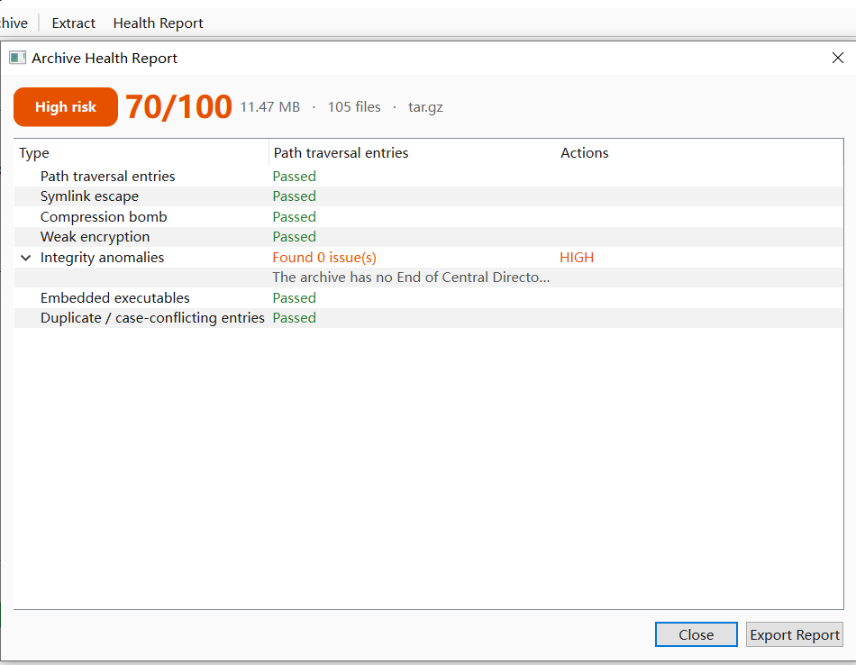
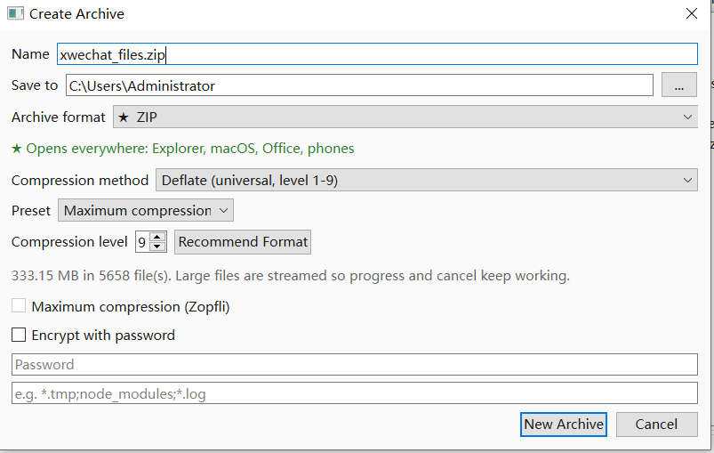
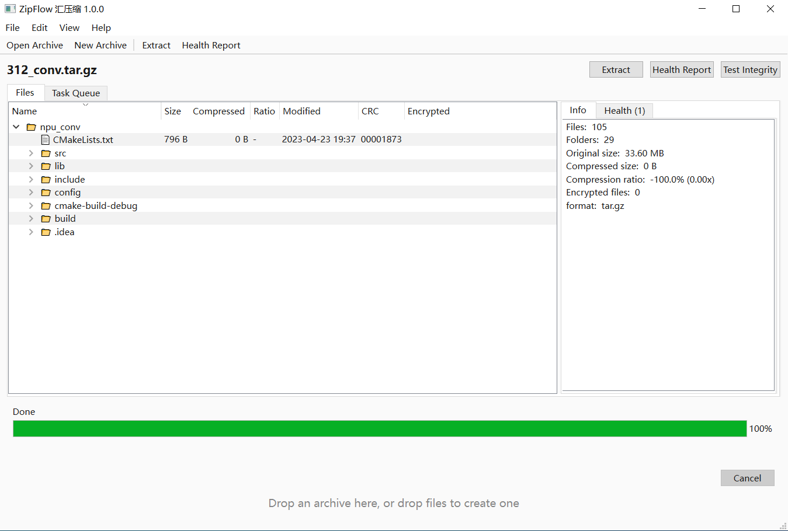
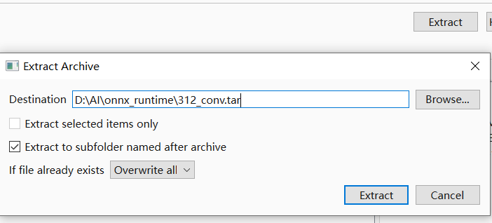
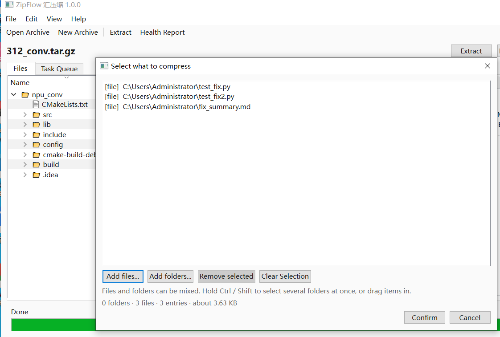

<div align="center">


# ZipFlow · 汇压缩

**Know before you unzip.**

A free, local-first archive manager for Windows that checks safety before extraction and recommends compression with evidence.

[](https://lijiannan1241.github.io/ZipFlow/)
[](https://github.com/lijiannan1241/ZipFlow/releases)
[](https://lijiannan1241.github.io/ZipFlow/)
[](LICENSE)
[](https://lijiannan1241.github.io/ZipFlow/privacy.html)
[](https://lijiannan1241.github.io/ZipFlow/#formats)

[Website](https://lijiannan1241.github.io/ZipFlow/) · [中文](README.zh.md) · [Safe unzip guide](https://lijiannan1241.github.io/ZipFlow/safe-unzip.html) · [Compare](https://lijiannan1241.github.io/ZipFlow/compare.html) · [Privacy](https://lijiannan1241.github.io/ZipFlow/privacy.html)

</div>

---

**ZipFlow** is a free archive manager for Windows 10 and 11. It opens ZIP, 7z, TAR, RAR (with 7-Zip) and 25+ other formats **without extracting**, runs seven security checks, and returns a 0–100 health score with an exportable JSON report. Before compression, it samples the files and recommends a container, method and level with an estimated saving and runtime. The desktop app, the `zf` command line and the localhost HTTP API share one engine.

No account. No ads. No telemetry. The Microsoft Store package does not declare the `internetClient` capability, so Windows itself blocks network access.



*The health report names the failing check and the affected entries. A 70/100 score can still be labelled high risk because the label comes from the worst finding, not the average.*

## Why ZipFlow?

Most archive tools answer “how small?” and “how fast?”. ZipFlow answers the two questions that actually block people:

| The question | Typical tools | ZipFlow |
|---|---|---|
| **Is this archive safe to extract?** | CRC test or antivirus only | 7 structural checks, a 0–100 score, affected entry names, JSON export |
| **Which format and level should I use?** | A settings panel and a guess | A recommendation with estimated saving and runtime, based on the file mix |
| **Will the recipient be able to open it?** | Not mentioned | ★ opens everywhere · ◐ needs a newer OS · ! needs 7-Zip |
| **Can I automate it?** | GUI and CLI behave differently | One engine behind GUI, CLI and localhost API |

## The seven checks

ZipFlow reads the archive index before a single byte is written to disk.

| # | Check | What it looks for | Default |
|---|---|---|---|
| 1 | **Path traversal** (Zip Slip, CWE-22) | `../` segments, absolute paths, drive letters, UNC paths that resolve outside the destination | Blocked |
| 2 | **Symlink escape** | A link pointing outside the extraction root, followed by a write through it | Blocked |
| 3 | **Compression bomb** | Extreme expansion ratios, oversized declared output, entry counts that could exhaust disk or memory | Flagged |
| 4 | **Weak encryption** | Legacy ZipCrypto instead of AES-256, outdated parameters, unverifiable encrypted entries | Flagged |
| 5 | **Integrity anomalies** | Missing end-of-central-directory, truncated data, CRC mismatches, inconsistent size fields | Flagged |
| 6 | **Embedded executables** | `.exe`, `.scr`, `.bat`, `.cmd`, `.ps1`, `.lnk`, `.js`, macro-enabled Office files | Flagged |
| 7 | **Duplicate / case conflicts** | Two entries with the same path, or names that collide on case-insensitive Windows volumes | Flagged |

**Score:** starts at 100. Each finding subtracts by severity: low 3, medium 12, high 30, critical 60. A score of 100 means no issues were found. **Risk label:** the worst single finding, not the average.

> ZipFlow is **not an antivirus**. It checks archive structure and extraction attack patterns, not malware signatures. Keep Windows Security or another antivirus enabled, and treat a clean report as one signal, not a guarantee.

## Smart compression

```text
$ zf r ./project --prefer auto
Recommended: ZIP / deflate level 9 (max)
★ Opens everywhere — Windows Explorer, macOS, Office,
  phones, cloud drives — no extra software needed.
Reason: Mostly text and source code: ZIP with Deflate at the
  highest level. Slightly larger than 7z, but anyone can open it
  with a double click.
Estimated saving: 80.6% (194.83 KB -> 37.72 KB)
Estimated time: 0s
Composition: text documents: 8
```

Add `--info` to any create command to see the plan, the free disk space and the estimated result **without writing a file**.

Why ZIP by default? ZIP opens in Windows Explorer, macOS, Office, phones and cloud drives without installing anything. 7z is usually smaller, but the recipient needs 7-Zip or a compatible tool. ZipFlow defaults to the format that works everywhere and lets you choose 7z when size matters more.

## Download

| Channel | Best for | Link |
|---|---|---|
| **Microsoft Store** | MSIX install with automatic updates | [Search “ZipFlow” in the Store](https://apps.microsoft.com/search?query=ZipFlow) |
| **GitHub Releases** | Portable build, no installer, no registry writes | [Latest release](https://github.com/lijiannan1241/ZipFlow/releases) |
| **Product website** | Screenshots, guides, privacy policy | [lijiannan1241.github.io/ZipFlow](https://lijiannan1241.github.io/ZipFlow/) |

**System requirements:** 64-bit Windows 10 version 1809 or later, or Windows 11. MSIX download: about 53.9 MB. Portable build: about 130 MB on disk. Version 1.0.0.

## Quick start

```bash
# Scan before extracting; JSON for CI
zf s suspicious.zip --json

# Create the default: ZIP + Deflate L9
zf a dist.zip ./src

# Smaller output, but the recipient needs 7-Zip
zf a dist.7z ./src -f 7z

# Plan only: no file is written
zf a big.zip ./data --info

# Extract, recommend, test
zf x dist.zip -o ./out
zf r ./src --prefer auto
zf t dist.zip

# Localhost API with a bearer token
zf serve --port 8765
```

The source build uses `python -m zipflow --cli` instead of `zf`.

| Exit code | Meaning |
|---|---|
| 0 | Success |
| 1 | General error |
| 2 | Usage error |
| 3 | Security block: critical path traversal or symlink escape |
| 4 | Wrong password |
| 5 | External 7-Zip missing |

`zf s` returns `3` only for critical traversal or symlink findings. Other findings return `0`, so parse the JSON to enforce your own threshold for bombs, weak encryption or embedded executables.

## Formats

| Group | Formats | Direction |
|---|---|---|
| **Universal default** ★ | ZIP — Zip64, Deflate 1–9, AES-256, optional Zopfli | Read / write |
| **Smallest output** ! | 7z — solid dictionary, LZMA2 | Read / write |
| **Unix standards** | TAR, TAR.GZ, TAR.BZ2, TAR.XZ | Read / write |
| **Fast, newer systems** ◐ | TAR.ZST, Zstandard | Read / write |
| **Read-only** | RAR*, ISO*, CAB*, DMG*, LZ, CPIO, RPM, DEB, SquashFS, NSIS, VHD/VHDX/VDI/VMDK, WIM, UDF, EXT, ARJ, LZH, CHM, PPMd, multi-volume, OOXML | Read only |

\* RAR and some disk-image formats require an installed 7-Zip engine. RAR creation is not supported because the compression algorithm is proprietary. ZIP, 7z, TAR and the other built-in formats work without 7-Zip.

## Screenshots

| Create with a recommendation | Browse without extracting |
|---|---|
|  |  |
| **Extract with a policy** | **Mix files and folders** |
|  |  |

## Privacy

- No telemetry, analytics or crash uploads.
- No account, cloud sync or ads.
- No file names, paths or contents leave the device.
- The MSIX package does not declare the `internetClient` capability. Network access is blocked by Windows at the OS boundary.
- Settings live in `%APPDATA%\ZipFlow\settings.json`.
- The optional local API binds to `127.0.0.1` and requires a bearer token.

Read the full [privacy policy](https://lijiannan1241.github.io/ZipFlow/privacy.html) (English and Chinese).

## How it compares

| Capability | ZipFlow 1.0.0 | 7-Zip | WinRAR | Windows Explorer |
|---|---|---|---|---|
| Price and licence | Free, LGPL-3.0 | Free, LGPL (unRAR restriction) | Paid licence, trial | Included with Windows |
| Archive health report | **7 checks + score** | CRC test only | Test and recovery record | No |
| Compression recommendation | **Format, level, saving, time** | Manual settings | Manual profiles | None |
| Write formats | 7 containers | Many, including 7z and ZIP | RAR, ZIP and more | ZIP only |
| Create RAR | No | No | **Yes** | No |
| CLI + local API | **Yes, same engine** | CLI yes; API no | CLI yes; API no | No |
| Telemetry | **None, no network capability** | None | No product telemetry documented | Windows telemetry settings apply |

**Choose ZipFlow** for a safety check before extracting, compression recommendations, and one engine across GUI, CLI and API. **Choose 7-Zip** for the widest format matrix and raw compression control. **Choose WinRAR** if you must create RAR archives or use recovery records. **Use Windows Explorer** for a quick ZIP from a trusted source.

ZipFlow is not a fork of 7-Zip. It is an independent Python and PySide6 application. It can call an installed `7z.exe` for formats that need the external engine.

## FAQ

### Is ZipFlow free?

Yes. ZipFlow is free to download and use, with no account, ads, in-app purchases or usage limits. It is licensed under LGPL-3.0.

### Does ZipFlow collect any data?

No. There is no telemetry, analytics or cloud sync. The Microsoft Store package does not declare the `internetClient` capability, so Windows itself blocks network access. Files, filenames and archive paths never leave the device.

### Can ZipFlow open RAR files?

ZipFlow can list and extract RAR archives when 7-Zip is installed, because it uses the external 7-Zip engine to read the proprietary RAR format. RAR creation is not supported. Built-in formats such as ZIP, 7z and TAR work without 7-Zip.

### Does ZipFlow replace an antivirus?

No. It checks archive structure and known extraction attack patterns, not malware signatures. Keep Windows Security or another antivirus enabled, and treat a clean health report as one signal, not a guarantee.

### How does the health score work?

The score starts at 100. Each finding subtracts points by severity: low 3, medium 12, high 30, critical 60. A score of 100 means no issues were found. The risk label (low, medium, high or critical) comes from the most severe finding, and every report can be exported as JSON.

### What formats can ZipFlow create?

Seven containers: ZIP (the default), 7z, TAR, TAR.GZ, TAR.BZ2, TAR.XZ and TAR.ZST. ZIP supports Zip64, Deflate levels 1–9, AES-256 and optional Zopfli compression. Each option is labelled with whether the recipient can open it without extra software.

### Does ZipFlow work offline?

Yes. Every feature, including the local HTTP API, runs on your machine. The API binds to `127.0.0.1` and requires a bearer token. ZipFlow makes no outbound network requests.

### Is there a command-line interface?

Yes. The packaged app exposes `zf`, and the source build uses `python -m zipflow --cli`. Commands cover create, extract, list, test, recommend, health scan and a localhost API. Exit code 3 means a critical path traversal or symlink escape was found, which can gate a build.

### Which Windows versions are supported?

ZipFlow 1.0.0 supports 64-bit Windows 10 version 1809 or later, and Windows 11. It is distributed as an MSIX package through the Microsoft Store and as a portable build on GitHub.

### Why does ZipFlow default to ZIP instead of 7z?

ZIP opens in Windows Explorer, macOS, Office, phones and cloud drives without installing anything. 7z usually produces smaller files, but the recipient needs 7-Zip or a compatible tool. ZipFlow defaults to the format that works everywhere and lets you choose 7z when size matters more.

### Can I use ZipFlow in CI or a script?

Yes. `zf s archive.zip --json` prints a machine-readable report. The command returns exit code 3 when a critical path traversal or symlink escape is found, so it can fail a build. Other findings can be enforced with your own threshold by parsing the JSON.

## Documentation

- [Product website](https://lijiannan1241.github.io/ZipFlow/) — features, screenshots, CLI, formats and FAQ.
- [中文首页](https://lijiannan1241.github.io/ZipFlow/zh.html) — 完整中文产品页。
- [How to check if a ZIP file is safe](https://lijiannan1241.github.io/ZipFlow/safe-unzip.html) — the seven checks explained, with references to CWE-22, CVE-2007-4559 and 42.zip.
- [ZipFlow vs 7-Zip, WinRAR and Windows Explorer](https://lijiannan1241.github.io/ZipFlow/compare.html) — including when another tool is the better choice.
- [Privacy policy](https://lijiannan1241.github.io/ZipFlow/privacy.html) — English and Chinese.
- [llms.txt](https://lijiannan1241.github.io/ZipFlow/llms.txt) — structured product summary for AI retrieval.
- [Sitemap](https://lijiannan1241.github.io/ZipFlow/sitemap.xml).

## 中文简介

**ZipFlow（汇压缩）** 是一款免费、本地优先的 Windows 压缩解压软件。它在解压前读取压缩包结构，完成 **7 项安全检测**并给出 **0–100 评分**；压缩前采样文件构成，推荐格式、方法与档位，并预估节省空间与耗时。

- **7 项检测：** 路径穿越（Zip Slip，CWE-22）、符号链接逃逸、压缩炸弹、弱加密、完整性异常、内嵌可执行文件、重复或大小写冲突。
- **格式：** 读取 30+ 种（RAR 需安装 7-Zip），写入 ZIP、7z、TAR、TAR.GZ、TAR.BZ2、TAR.XZ、TAR.ZST 共 7 种容器。
- **三种入口：** GUI、`zf` 命令行、本地 HTTP API 共用同一引擎；发现严重的路径穿越或符号链接逃逸时返回退出码 3。
- **隐私：** 无遥测、无账号、无云同步；MSIX 清单不声明 `internetClient` 能力，由 Windows 阻断联网。
- **平台：** 64 位 Windows 10 1809+ / Windows 11，版本 1.0.0，LGPL-3.0。

完整中文介绍见 [zh.html](https://lijiannan1241.github.io/ZipFlow/zh.html)，或阅读 [README.zh.md](README.zh.md)。

## License

ZipFlow is licensed under the [GNU Lesser General Public License v3.0](LICENSE). Third-party components and their licences are included with the application.

ZipFlow is not affiliated with 7-Zip, WinRAR, WinZip, PeaZip, NanaZip or Bandizip. All trademarks belong to their respective owners.

## Contact

- Bug reports and corrections: [GitHub Issues](https://github.com/lijiannan1241/ZipFlow/issues)
- Website: [lijiannan1241.github.io/ZipFlow](https://lijiannan1241.github.io/ZipFlow/)
- Repository: [github.com/lijiannan1241/ZipFlow](https://github.com/lijiannan1241/ZipFlow)

---

<sub>Last reviewed: 3 November 2026 · Applies to ZipFlow 1.0.0</sub>
