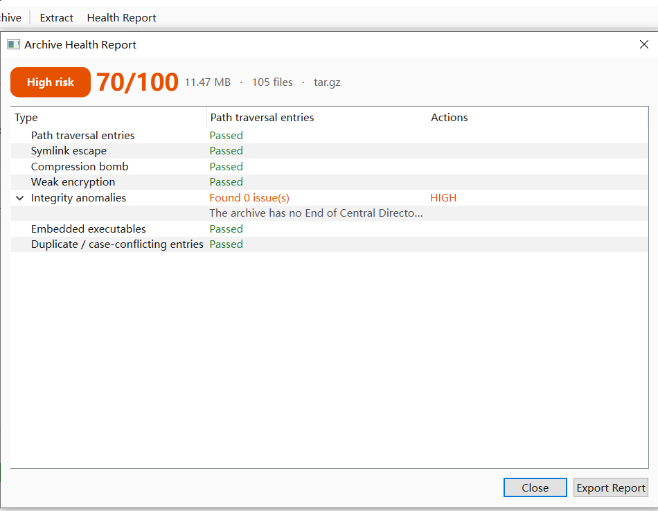
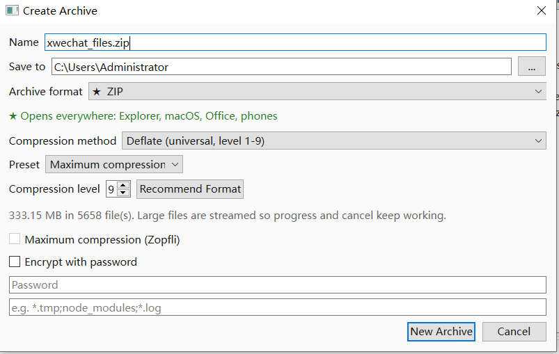
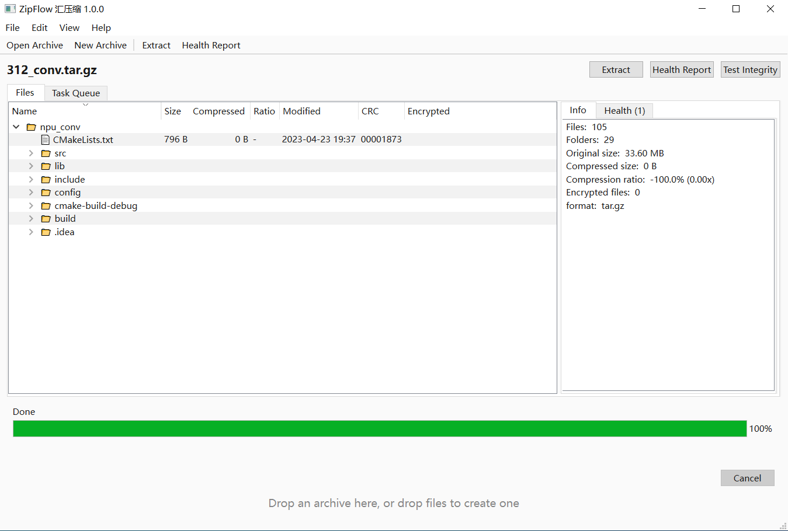
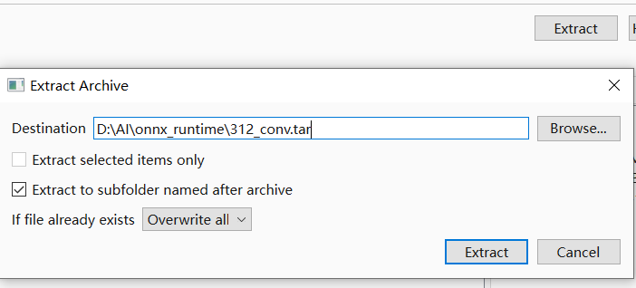
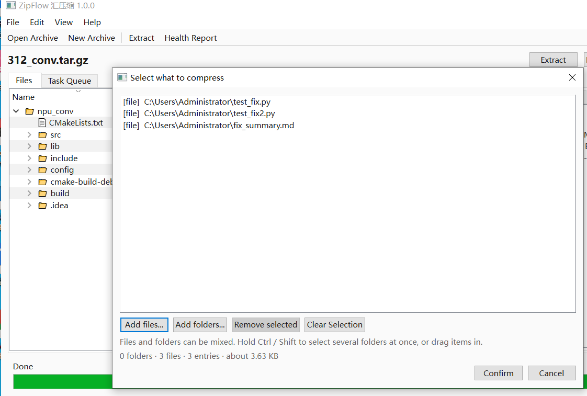

<div align="center">


# ZipFlow · 汇压缩

**解压之前，先知道它安不安全。**

免费、本地优先的 Windows 压缩解压软件：解压前做安全体检，压缩前给出有依据的方案。

[](https://lijiannan1241.github.io/ZipFlow/zh.html)
[](https://github.com/lijiannan1241/ZipFlow/releases)
[](https://lijiannan1241.github.io/ZipFlow/zh.html)
[](LICENSE)
[](https://lijiannan1241.github.io/ZipFlow/privacy.html)
[](https://lijiannan1241.github.io/ZipFlow/zh.html#formats)

[中文官网](https://lijiannan1241.github.io/ZipFlow/zh.html) · [English](README.md) · [安全解压指南](https://lijiannan1241.github.io/ZipFlow/safe-unzip.html) · [工具对比](https://lijiannan1241.github.io/ZipFlow/compare.html) · [隐私政策](https://lijiannan1241.github.io/ZipFlow/privacy.html)

</div>

---

**ZipFlow（汇压缩）** 是一款面向 Windows 10 / 11 的免费压缩解压软件。它**不解压**就能读取 ZIP、7z、TAR、RAR（需 7-Zip）等 30+ 种压缩包，完成 7 项安全检测，给出 0–100 评分和可导出的 JSON 报告；压缩前采样文件构成，推荐容器、方法与档位，并预估节省空间和耗时。图形界面、`zf` 命令行和本地 HTTP API 共用同一引擎。

没有账号，没有广告，没有遥测。微软商店安装包不声明 `internetClient` 能力，Windows 在系统层面阻断联网。



*体检报告会列出具体检测项和受影响条目。70/100 也可能标为高风险，因为风险等级取最严重的那一项，而不是平均分。*

## 为什么需要 ZipFlow？

大多数压缩工具只回答“能压多小”和“能压多快”。ZipFlow 先回答真正让人犹豫的两个问题：

| 问题 | 常见工具 | ZipFlow |
|---|---|---|
| **这个包能安全解压吗？** | 只做 CRC 测试，或交给杀毒软件 | 7 项结构检测、0–100 评分、具体条目名、JSON 导出 |
| **该选什么格式和档位？** | 给一堆参数让你猜 | 根据文件构成推荐，并预估节省空间与耗时 |
| **对方能直接打开吗？** | 不说明 | ★ 到处都能开 · ◐ 需要较新系统 · ! 需要 7-Zip |
| **能接进脚本吗？** | GUI 和 CLI 行为不一致 | GUI、CLI、本地 API 同一引擎 |

## 7 项安全检测

ZipFlow 在写入第一个字节之前，先读完压缩包索引。

| # | 检测项 | 查什么 | 默认动作 |
|---|---|---|---|
| 1 | **路径穿越**（Zip Slip，CWE-22） | `../`、绝对路径、盘符、UNC 路径等会逃出目标目录的条目 | 拦截 |
| 2 | **符号链接逃逸** | 指向解压目录之外的链接，以及随后借它写入的条目 | 拦截 |
| 3 | **压缩炸弹** | 异常膨胀比、超大的声明解压体积、可能耗尽磁盘或内存的条目数量 | 标记 |
| 4 | **弱加密** | 旧式 ZipCrypto 而非 AES-256、参数过时、无法校验的加密条目 | 标记 |
| 5 | **完整性异常** | 缺少中央目录结束记录、数据截断、CRC 不匹配、大小字段矛盾 | 标记 |
| 6 | **内嵌可执行文件** | `.exe`、`.scr`、`.bat`、`.cmd`、`.ps1`、`.lnk`、`.js`、带宏的 Office 文件 | 标记 |
| 7 | **重复 / 大小写冲突** | 同一路径出现两次，或在 Windows 不区分大小写的卷上互相覆盖 | 标记 |

**评分：** 满分 100，按严重程度扣分：低 3 分、中 12 分、高 30 分、严重 60 分。100 分表示没有发现问题。**风险等级：** 取最严重的那一项，而不是平均分。

> ZipFlow **不是杀毒软件**。它检查压缩包结构和解压攻击模式，不查病毒特征。请继续开启 Windows 安全中心或其他杀毒软件，并把干净的体检报告视为一个信号，而不是保证。

## 智能压缩

```text
$ zf r ./project --prefer auto
推荐：ZIP / deflate 级别 9（极限压缩）
★ 全市场通吃 —— Windows 资源管理器、macOS、Office、
  手机、云盘，无需安装任何软件。
理由：以文本和源码为主：ZIP + Deflate 最高级别。
  比 7z 略大一点，但谁都能双击打开。
预计节省：80.6%（194.83 KB -> 37.72 KB）
预计耗时：0 秒
内容构成：文本文档 8
```

在任何创建命令后加 `--info`，可以在**不写文件**的情况下看到方案、剩余磁盘空间和预计结果。

为什么默认 ZIP？ZIP 在 Windows 资源管理器、macOS、Office、手机和云盘上都能直接打开，接收方不需要装软件。7z 通常更小，但对方需要 7-Zip 或兼容工具。ZipFlow 默认选兼容性最好的格式，需要更小体积时可以显式选 7z。

## 下载

| 渠道 | 适合 | 链接 |
|---|---|---|
| **微软商店** | MSIX 安装，自动更新 | [在 Microsoft Store 获取](https://apps.microsoft.com/detail/9np4kw9lpgft?cid=DevShareMCLPCS&hl=zh-CN&gl=CN) |
| **GitHub Releases** | 免安装版，不写注册表 | [最新版本](https://github.com/lijiannan1241/ZipFlow/releases) |
| **产品官网** | 截图、指南、隐私政策 | [lijiannan1241.github.io/ZipFlow/zh.html](https://lijiannan1241.github.io/ZipFlow/zh.html) |

**系统要求：** 64 位 Windows 10 1809 及以上，或 Windows 11。MSIX 下载约 53.9 MB；免安装版约占 130 MB 磁盘空间。版本 1.0.0。

## 快速开始

```bash
# 解压前体检；JSON 给 CI 用
zf s suspicious.zip --json

# 默认产物：ZIP + Deflate L9
zf a dist.zip ./src

# 体积更小，但接收方需要 7-Zip
zf a dist.7z ./src -f 7z

# 只看方案，不写文件
zf a big.zip ./data --info

# 解压、推荐、完整性测试
zf x dist.zip -o ./out
zf r ./src --prefer auto
zf t dist.zip

# 本地 API（Bearer Token）
zf serve --port 8765
```

源码运行时使用 `python -m zipflow --cli` 代替 `zf`。

| 退出码 | 含义 |
|---|---|
| 0 | 成功 |
| 1 | 一般错误 |
| 2 | 参数错误 |
| 3 | 安全拦截：严重的路径穿越或符号链接逃逸 |
| 4 | 密码错误 |
| 5 | 缺少外部 7-Zip |

`zf s` 只在发现严重的路径穿越或符号链接逃逸时返回 `3`。其他发现返回 `0`，可以在解析 JSON 后按自己的阈值处理压缩炸弹、弱加密或内嵌可执行文件。

## 支持格式

| 分组 | 格式 | 方向 |
|---|---|---|
| **默认 · 全市场通吃** ★ | ZIP —— Zip64、Deflate 1–9、AES-256、可选 Zopfli | 读 / 写 |
| **体积最小** ! | 7z —— 固实字典、LZMA2 | 读 / 写 |
| **Unix 标准** | TAR、TAR.GZ、TAR.BZ2、TAR.XZ | 读 / 写 |
| **高速 · 较新系统** ◐ | TAR.ZST、Zstandard | 读 / 写 |
| **仅读取** | RAR*、ISO*、CAB*、DMG*、LZ、CPIO、RPM、DEB、SquashFS、NSIS、VHD/VHDX/VDI/VMDK、WIM、UDF、EXT、ARJ、LZH、CHM、PPMd、多卷、OOXML | 仅读取 |

\* RAR 和部分磁盘镜像格式需要系统安装 7-Zip。RAR 压缩算法专有，因此不支持创建 RAR。ZIP、7z、TAR 等内置格式无需 7-Zip。

## 界面截图

| 新建压缩包，带推荐 | 不解压直接浏览 |
|---|---|
|  |  |
| **带策略解压** | **文件和文件夹混选** |
|  |  |

## 隐私

- 没有遥测、统计分析或崩溃上传。
- 没有账号、云同步或广告。
- 文件名、路径和文件内容都不会离开本机。
- MSIX 清单不声明 `internetClient` 能力，网络访问由 Windows 在系统边界阻断。
- 设置保存在 `%APPDATA%\ZipFlow\settings.json`。
- 可选的本地 API 只绑定 `127.0.0.1`，并要求 Bearer Token。

完整说明见[隐私政策](https://lijiannan1241.github.io/ZipFlow/privacy.html)（中英文）。

## 工具对比

| 能力 | ZipFlow 1.0.0 | 7-Zip | WinRAR | Windows 资源管理器 |
|---|---|---|---|---|
| 价格与许可证 | 免费，LGPL-3.0 | 免费，LGPL（unRAR 限制） | 付费许可，有试用 | 随 Windows 提供 |
| 压缩包体检 | **7 项 + 评分** | 仅 CRC 测试 | 测试与恢复记录 | 无 |
| 压缩方案推荐 | **格式、档位、节省、耗时** | 手动设置 | 手动配置 | 无 |
| 可写格式 | 7 种容器 | 多种，含 7z 与 ZIP | RAR、ZIP 等 | 仅 ZIP |
| 创建 RAR | 否 | 否 | **是** | 否 |
| CLI + 本地 API | **有，同一引擎** | 有 CLI，无 API | 有 CLI，无 API | 无 |
| 遥测 | **无，且无联网能力** | 无 | 未见产品遥测说明 | 受系统遥测设置影响 |

**选 ZipFlow**：解压前要安全检查、需要压缩建议、希望 GUI / CLI / API 行为一致。**选 7-Zip**：需要最全的格式矩阵和最大的压缩参数控制权。**选 WinRAR**：必须创建 RAR 或依赖恢复记录。**用资源管理器**：偶尔打开可信来源的 ZIP。

ZipFlow 不是 7-Zip 的分支，而是独立的 Python + PySide6 应用。只在需要外部引擎的格式上调用已安装的 `7z.exe`。

## 常见问题

### ZipFlow 是免费的吗？

是。免费下载、免费使用，没有账号、广告、内购或功能次数限制。许可证为 LGPL-3.0。

### ZipFlow 会收集我的数据吗？

不会。没有遥测、统计分析或云同步。微软商店安装包不声明 `internetClient` 能力，Windows 在系统层面阻止联网。文件、文件名和压缩包路径都不会离开本机。

### ZipFlow 能解压 RAR 吗？

可以列出和解压，但需要系统安装 7-Zip：RAR 压缩算法专有，ZipFlow 通过外部 7-Zip 引擎读取。不支持创建 RAR。ZIP、7z、TAR 等内置格式无需 7-Zip。

### ZipFlow 能代替杀毒软件吗？

不能。它检查压缩包结构和已知的解压攻击模式，不查病毒特征。请继续开启 Windows 安全中心或其他杀毒软件，并把干净的体检报告视为一个信号，而不是保证。

### 体检评分是怎么算的？

满分 100，按严重程度扣分：低 3 分、中 12 分、高 30 分、严重 60 分。100 分表示没有发现问题。风险等级取最严重的那一项；所有报告都可以导出 JSON。

### ZipFlow 能创建哪些格式？

支持 7 种容器：ZIP（默认）、7z、TAR、TAR.GZ、TAR.BZ2、TAR.XZ 和 TAR.ZST。ZIP 支持 Zip64、Deflate 1–9 级、AES-256 加密以及可选的 Zopfli 极限压缩。每个选项都会标注接收方能否直接打开。

### 支持命令行吗？

支持。安装版提供 `zf`，源码运行使用 `python -m zipflow --cli`。命令覆盖创建、解压、列表、测试、推荐、体检和本地 API。发现严重的路径穿越或符号链接逃逸时返回退出码 3，可直接用于 CI 卡点。

### 支持哪些 Windows 版本？

ZipFlow 1.0.0 支持 64 位 Windows 10 1809 及以上版本，以及 Windows 11。微软商店提供 MSIX 安装包，GitHub 提供免安装版本。

### 为什么默认用 ZIP，而不是压缩率更高的 7z？

ZIP 在 Windows 资源管理器、macOS、Office、手机和云盘上都能直接打开，接收方不需要装任何软件。7z 通常更小，但对方需要 7-Zip 或兼容工具。ZipFlow 默认选兼容性最好的格式，需要更小体积时可以显式选 7z。

### 可以在脚本或 CI 里使用吗？

可以。`zf s archive.zip --json` 输出机器可读的体检报告；发现严重的路径穿越或符号链接逃逸时返回退出码 3，可让构建失败。其他发现可以解析 JSON 后按自己的阈值处理。

## 文档与链接

- [中文产品官网](https://lijiannan1241.github.io/ZipFlow/zh.html) — 功能、截图、命令行、格式与常见问题。
- [English site](https://lijiannan1241.github.io/ZipFlow/) — English product page.
- [如何判断 ZIP 是否安全](https://lijiannan1241.github.io/ZipFlow/safe-unzip.html) — 7 项检测详解，附 CWE-22、CVE-2007-4559 与 42.zip 参考。
- [ZipFlow 与 7-Zip、WinRAR、资源管理器对比](https://lijiannan1241.github.io/ZipFlow/compare.html) — 包括什么时候应该选别的工具。
- [隐私政策](https://lijiannan1241.github.io/ZipFlow/privacy.html) — 中英文。
- [llms.txt](https://lijiannan1241.github.io/ZipFlow/llms.txt) — 面向 AI 检索的结构化产品摘要。
- [Sitemap](https://lijiannan1241.github.io/ZipFlow/sitemap.xml)。

## 许可证

ZipFlow 以 [GNU Lesser General Public License v3.0](LICENSE) 发布。第三方组件及其许可证随应用提供。

ZipFlow 与 7-Zip、WinRAR、WinZip、PeaZip、NanaZip、Bandizip 无任何关联。所有商标归其各自所有者。

## 反馈

- 问题反馈与更正：[GitHub Issues](https://github.com/lijiannan1241/ZipFlow/issues)
- 官网：[lijiannan1241.github.io/ZipFlow](https://lijiannan1241.github.io/ZipFlow/zh.html)
- 仓库：[github.com/lijiannan1241/ZipFlow](https://github.com/lijiannan1241/ZipFlow)

---

<sub>最后更新：2026 年 11 月 3 日 · 适用于 ZipFlow 1.0.0</sub>
